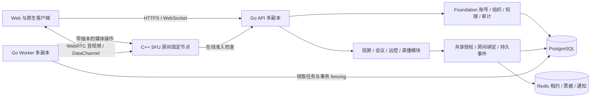

# 多业务控制面

本版本将 `business-api` 切换到 Foundation 装配的组织隔离控制面。新入口只提供 `/api/v1/av` 业务协议；旧包保留作行为回归参照，旧 HTTP 路由、旧 SQLite 数据与旧客户端不自动升级。

## 所有权与进程

Foundation 是 `platform-foundation/server` Go 源码依赖，随 AV 平台运行并拥有账号、组织、权限、审计与队列表。AV 拥有业务表、媒体授权、节点分配、Redis 实时设施。账号和组织不在 AV 重新建模。业务约束由 `internal/businesses/v2` 内四组用例维护，通过 `modules.go` 注册 URL 前缀、资源类型与命令处理器；当前仍在一个 Go 包内，尚未物理拆成四组 domain/application/repository 包。`internal/platform/control` 提供事务、媒体和实时机制；`internal/bootstrap/av_*` 装配认证、HTTP、配置与任务。

同一二进制支持 `migrate`、`bootstrap`、`api`、`worker`、`serve`、`openapi`。API 和 Worker 使用同一模块注册；关闭业务模块拒绝其 HTTP 操作和媒体准入，Worker 清理该模块遗留会话。正常启动不建表、不终止仍启用模块的有效会话。生产 PostgreSQL + Redis；SQLite + memory 仅为显式开发配置。

## 数据与授权

所有资源归 `org:<id>`；基础成员角色为 `av-member`，运营角色为 `av-operator`。组织创建者在 `/api/v1/av/organizations/initialize` 初始化角色，现有角色不会被重置。访客凭配对码、会议号/口令或公开场次进入单个资源，服务端只存凭证哈希。访客不能选择任意组织或调用组织 API。用户会话、API Key、资源凭证、RTCGrant、ControlGrant 的用途互相独立。

业务 SQL 使用 Foundation scope 事务、索引列、条件更新与唯一约束；事务同时提交业务幂等结果、审计、事件和待执行媒体操作。外部 SFU、Redis、WebSocket 调用不进入业务事务。Foundation 的同 scope 写锁仍是性能边界，聊天有业务限频；高频心跳和远控续租不写该事务路径。

`av_resources` 保存公共可索引元数据；配对、会议席位与共享者、直播场次/连麦/PK/积分、远控同意分别存业务表。房间绑定包含节点、节点启动代次和房间代次，每代使用全新媒体房间名。一个直播场次分别绑定节目和互动房；PK 两主播共享同一互动房。

## 媒体控制

媒体帧和输入 DataChannel 直达 SFU。Go 通过受信节点元数据与条件操作接口管理媒体，不代理媒体包。JWT 固定60秒，包含授权 ID、权限版本、节点与启动代次、房间代次、授权绝对期限；签发和准入都检查当前业务状态、成员、组织与用户状态。

SFU 必须开启 AV 模式；参数和协议见相邻 `livekit-cpp/docs/AV_CONTROL.md`。新连接、resume、validate 与刷新都执行在线准入；RTC 与管理密钥独立。受信管理操作携带操作 ID 和版本，删除后的房间名/参与者 identity 不再复用，阻止迟到命令恢复旧权限。

`CreateRoom` 等操作由持久队列执行；响应返回 grant ID，房间未就绪时凭证接口返回409 `media_preparing`，客户端有界重试。资源结束先拒绝授权，再异步移除参与者/删房；结束响应中的 `accepted:true` 与 `operation_ids` 表示已接受清理，可用 `GET /api/v1/av/operations/{id}` 查询单项，或用 `GET /api/v1/av/operations?resource_id=...` 查询最近200项。失败操作保留状态并可通过运维队列重试；JWT 过期不等于已经建立的媒体连接立即断开。

远控需要被控端本地同意。PG 保存授权、主体和 epoch；Redis 存独立短租约。租约只能在原值匹配且仍存在时延长，丢失/过期不能续租重建。每三秒申请续租，上限十秒并扣除请求耗时；被控端按单调时钟停止注入并释放按键。业务撤销推送加快停止，正确性不依赖推送。API短暂故障仅能在原截止时间内重试；重新媒体连接要求重新同意。

## 事件与恢复

数据库事件按资源 sequence 排序，Outbox 投递 Redis 通知，API 多副本各自通知本机连接。通知可以丢失；WebSocket每秒补查持久事件，客户端也可按游标补拉，单页200。WS票据30秒有效且只消费一次，连接最长60秒后重新认证；后续投递重新检查主体和资源权限。当前事件没有自动删除任务，因此不存在静默跳过已删除游标的问题；后续引入保留期时必须加入快照重置协议。

SFU节点固定承载房间。节点启动代次变化使旧凭证失效，新房间需要新绑定/凭证；不提供跨节点无缝接续。API重启保留有效业务状态。Redis丢失使远控停止；会议和直播结合媒体观察判断失联，不把通知/在线缓存丢失当作结束事实。

## 当前业务界限

- 投屏：一发一收，五分钟一次性码，30秒在线检测。
- 会议：即时/预约、等候室、主持转移、共享互斥，25人含等候席位，两分钟恢复窗口。
- 远控：有人值守单控制者，一小时本次同意绝对上限，独立十秒短租约；不支持无人值守。
- 直播：WebRTC节目/互动双房，主播加三嘉宾，PK与嘉宾互斥，每组织默认五场并发；免费积分/礼物不涉及支付。客户端本地录制保持独立。

RTMP/HLS/CDN、云录制、多地域、无人值守及生产容量承诺不在本次实现范围。GraphEngine继续承载客户端及未来媒体Worker流水线。
